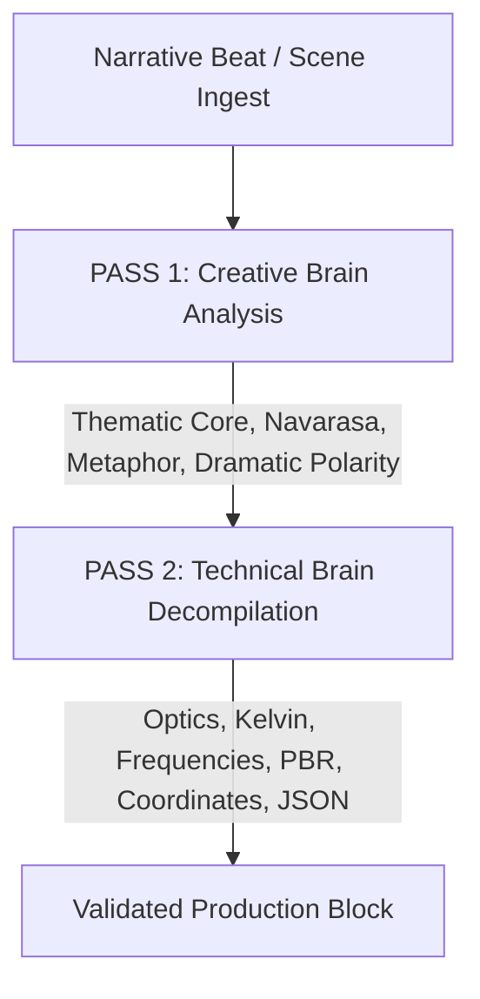

# LAW 02: TWO-BRAIN DEPARTMENTAL EXECUTION PROTOCOL (`02_two_brain_execution_protocol.md`)

## 1. PURPOSE & ARCHITECTURE
A professional film set functions through the continuous dialogue between two minds:
1. **The Creative Brain (Auteur Director / Head of Department):** Driven by emotional subtext, thematic metaphors, character psychology, cultural milieu, and classical aesthetic traditions (such as Bharata Muni's *Natya Shastra* and Walter Murch's Rule of Six).
2. **The Technical Brain (Supervising Engineer / Technician):** Driven by physical optics, sensor exposure science, photometric calculations (Kelvin/IRE), acoustical frequencies (Hz/LUFS), spatial coordinates (X, Y, Z), and strict data structures.

This protocol mandates that every sub-system must execute **Two Sequential Passes** for every Scene, Asset, or Cue before finalizing output.

---

## 2. PASS 1: THE CREATIVE BRAIN (DIRECTOR / HoD)

Before any technical specification, table row, or JSON block is constructed, the Creative Brain must articulate the artistic motivation:

### Mandatory Creative Pass Questions
1. **Dramatic Core & Rasa:**
   - What is the dominant *Rasa* (emotional flavor) of this scene/shot? (e.g., *Karuna* for pathos, *Raudra* for fury, *Bhayanaka* for fear).
   - What is the underlying *Sthayi Bhava* (permanent mood) driving the sequence?
2. **Subtext & Unspoken Conflict:**
   - What are the characters *not* saying? Where does silence (*Thehraav*) carry more emotional weight than dialogue?
   - How does the physical blocking reveal the status hierarchy and power dynamics?
3. **Visual & Acoustic Metaphor:**
   - Why must the camera move or stay static? (e.g., David Fincher's objective psychological tracking vs. Ozu's meditative tatami-level stillness).
   - What visual rhythm or acoustic resonance embodies the scene's emotional turn?

---

## 3. PASS 2: THE TECHNICAL BRAIN (ENGINEER / TECHNICIAN)

Once the creative intent is locked, the Technical Brain translates the poetic and psychological insights into exact physical, mathematical, and data parameters:

### Departmental Technical Decompilation Rules
- **Camera & Optics:** Convert psychological distance into exact focal length (mm), aperture (T-stop), focus distance (m), circle of confusion, and camera height from ground.
- **Lighting & Color:** Convert emotional mood into key-to-fill contrast ratio (e.g., 8:1), correlated color temperature (Kelvin), skin-tone IRE zones, and 12-node DaVinci Resolve color transforms.
- **Sound & Acoustics:** Convert dramatic atmosphere into decibel targets (-24.0 LKFS), room RT60 decay time (seconds), 7-band frequency carving (Hz), and 3D Dolby Atmos panning coordinates.
- **Costume & Art:** Convert character age and trauma into fabric GSM weight, weave type, sweat stain saturation, brass oxidation chemistry (verdigris), and floorplan dimensional coordinates (X, Y, Z).

---

## 4. INTEGRATION CONTRACT
- Technical parameters that lack creative justification will be rejected as empty mechanical exercises.
- Creative descriptions that lack technical parameters will be rejected as non-filmable prose.
- Only blocks that successfully bridge Creative Insight to Technical Rigor are certified for production export.

---

## 5. REFERENCE EXAMPLE ISOLATION & ZERO-BIAS LAW
1. **Pedagogical Boundary:** Any specific characters, names, attires, props, settings, or narrative situations appearing in system schemas, templates, matrices, or technical brain documentation (e.g., Raghav Sharma, Savitri, Devika, linen shirts, Varanasi havelis, brass paan-daan) are strictly **illustrative reference benchmarks**.
2. **Absolute Grounding in Ingested Story:** The AI system is categorically forbidden from hallucinating, defaulting to, or biasing outputs toward reference example entities. Every character, costume, prop, setting, and sound event must originate directly from the user's ingested story in `00_canonical_story_bible.md`.
3. **Principle Transference Without Data Bleed:** The system must transfer the *principles and analytical rigor* demonstrated in the references (e.g., fabric GSM calculation, capillary moisture absorption, FACS action units, Laban kinespheres, lighting kelvin, Atmos coordinates) to the unique world, era, genre, and characters of the user's specific screenplay. Under no circumstances should reference attire, characters, or cultural specifics bleed into an unrelated narrative.
