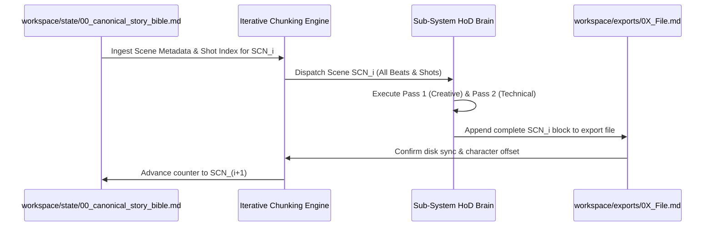

# LAW 04: SCENE-BY-SCENE ITERATIVE CHUNKING ENGINE (`04_scene_by_scene_iterative_chunking_engine.md`)

## 1. THE CONTEXT WINDOW BOTTLENECK
A feature film narrative or multi-episode web series contains between 40 and 120 scenes, requiring hundreds of pages of script and thousands of individual camera set-ups. Requesting an AI model to generate an entire 15-scene Shot Breakdown or Screenplay in a single generation response guarantees catastrophic token overflow, leading to aggressive summarization and truncation.

To ensure production-grade depth, this law enforces **Stateful, Scene-by-Scene Iterative Batch Generation**.

---

## 2. THE 5-STAGE ITERATION CYCLE

### Stage 1: Scene Scope Isolation
Before generation begins, the engine reads `workspace/state/00_canonical_story_bible.md` and isolates the target `SCN_XX` block. It retrieves:
- Scene Slugline & Solar/Lighting Clock
- Master Character UUIDs present in scene
- Prop UUIDs and Location UUID
- Target pre-calculated shots (`SHT_01A`, `SHT_01B`...)

### Stage 2: Deep Scene Decompilation
The Sub-System builds the target scene in full depth without concern for downstream scenes. Every single shot, beat, audio cue, and node is fully written out.

### Stage 3: File Appending & Disk Persistence
The generated block is appended directly to the target export file (e.g., `workspace/exports/02_Shot_Breakdown.md`). The system does NOT hold all scenes in memory before writing.

### Stage 4: Quality Gate & Linter
The appended section is checked against `03_banned_tokens_and_lazy_phrase_blacklist.md` and the departmental `.audit.md`. If passed, state checkpoint is committed.

### Stage 5: Iterative Progression
The engine moves to the next scene (`SCN_02`, `SCN_03`... `SCN_N`) until the narrative arc is completely rendered.

---

## 3. RULES OF ENGAGEMENT
1. **Never Buffer Entire Acts:** Do not wait for an entire act to finish before writing to disk. Every completed scene must be flushed to the workspace immediately.
2. **Deterministic Numbering:** Shot numbering must strictly follow `ACT_SCN_SHT` hierarchy (e.g., `ACT1_SCN01_SHT01A`), preventing numbering drift across chunks.
3. **Resume Capability:** If a session disconnects, the engine inspects the last written Scene ID in `workspace/exports/` and resumes from `SCN_(N+1)`.
