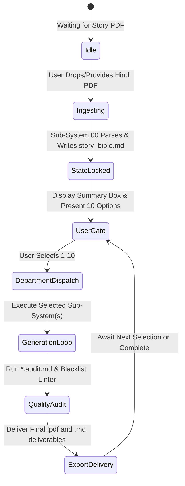

# LAW 08: INTERACTIVE USER ROUTING MENU PROTOCOL (`08_interactive_user_routing_menu_protocol.md`)

## 1. PURPOSE & STATE MACHINE
The Autonomous Studio System does not flood the user with thousands of lines of output immediately upon receiving a Hindi Story PDF. Instead, it operates as an **Intelligent Interactive Showrunner State Machine**:



---

## 2. THE THREE EXECUTION PHASES

### Phase 1: Silent Canonical Ingestion (Sub-System 00)
When a user provides a Hindi narrative text or PDF:
1. The Root Router invokes `00_story_ingestion_subsystem/SKILL.md`.
2. It parses the entire story without abridgment, mapping:
   - Act boundaries (`ACT_01`, `ACT_02`, `ACT_03`)
   - Every scene (`SCN_01` to `SCN_N`) with dramatic objectives and Navarasa tags.
   - Every required shot (`SHT_01A`, `SHT_01B`...) calculated from beat density.
   - Persistent entity registries (`CHAR_XX`, `PROP_XX`, `LOC_XX`).
3. **Dynamic Project Directory Allocation (Google Drive Sync Standard):**
   The system automatically parses the story title from the ingested text, sanitizes it into `{PROJECT_SCRIPT_TITLE}` (e.g., `threshold_of_return` or `kuch_ghar_eent_aur_patthar_se_nahi`), and establishes the dedicated directory tree:
   ```
   workspace/projects/{PROJECT_SCRIPT_TITLE}/
   ├── 00_Project_Bible_and_Canonical_State/
   │   ├── 00_canonical_story_bible.md
   │   └── 00_project_metadata.json
   ├── 01_Creative_Master_Suite/
   │   ├── 01_Script_Creative_Master.md (.pdf)
   │   ├── 02_Shot_Breakdown_Creative_Master.md (.pdf)
   │   ├── 03_Voiceover_Creative_Master.md (.pdf)
   │   └── 04_Storyboarding_Creative_Master.md
   ├── 02_Technical_Master_Suite/
   │   ├── 01_Script_Technical_Master.md
   │   ├── 02_Shot_Breakdown_Technical_Master.md (.pdf)
   │   ├── 03_Voiceover_Technical_Master.md
   │   ├── 04_Storyboarding_Technical_Master.md
   │   ├── 05_Color_Grading_Technical_Master.md
   │   ├── 06_Sound_Design_Technical_Master.md
   │   ├── 07_Character_Technical_Master.md
   │   ├── 08_Prop_Technical_Master.md
   │   └── 09_Location_Technical_Master.md
   └── 03_Production_Logs_and_Audits/
       ├── 00_ingestion_completeness.audit.md
       └── production_manifest.json
   ```
   *(Note: For backward compatibility, the canonical bible is simultaneously referenced in `workspace/state/00_canonical_story_bible.md` and legacy exports are mirrored in `workspace/exports/`).*

---

### Phase 2: The Canonical Ingestion Summary Box & Selection Gate (STOP & ASK)
Immediately upon locking the canonical bible, the agent halts autonomous output generation and presents the interactive showrunner menu:

```markdown
┌────────────────────────────────────────────────────────────────────────┐
│               CANONICAL STORY BIBLE LOCKED (STATE READY)               │
├────────────────────────────────────────────────────────────────────────┤
│ Story Title (Hindi / Eng): कुछ घर ईंट और पत्थर से नहीं (Threshold of Return) │
│ Total Acts: 3 Acts (Act I: 18 min | Act II: 42 min | Act III: 24 min)   │
│ Total Scenes: 14 Scenes                                                │
│ Total Pre-Calculated Cuts: 168 Discrete Shots                          │
│ Entity Registry: 4 Characters | 11 Props | 6 Locations                 │
│ Project Workspace: `workspace/projects/{PROJECT_SCRIPT_TITLE}/`        │
└────────────────────────────────────────────────────────────────────────┘

STEP 1: SELECT PRODUCTION TEMPLATE FORMAT
[T1] Template 1: Short Episode Film (6–7 Minutes) — 25–27 Shots/Min, ~3s avg shot (150–189 Shots)
[T2] Template 2: Social Micro-Short (60 Seconds) — 30–40 High-Energy Shots, 1.5–2s avg shot
[T3] Template 3: Episodic Drama (26–30 Minutes) — Standard Series Arc, 400–500 Shots
[T0] Standard Story Feature (Dynamic pacing as dictated by raw script)

STEP 2: SELECT DELIVERABLE OUTPUT MODE (Creative vs Technical)
[M1] Creative Master Suite (Executive / Client Edition) — Clean prose script to requested page length, 10-column shot tables ONLY (no technical blocks), plain prose voiceover script.
[M2] Technical File Master Suite (Deep Engineering Decompilation) — Full drop-down of all generation options: Cooke/ARRI optical metadata, FACS Action Units, ACES 12-node trees, 7.1.4 Atmos routing, PBR physics.
[M3] Unified Studio Master (Generate BOTH Creative and Technical Suites in their respective folders).

STEP 3: SELECT TARGET DEPARTMENT DELIVERABLE(S)
1. Master Screenplay / Script (`01_Script`)
2. Master Shot Breakdown (`02_Shot_Breakdown`)
3. Voiceover & Acoustic Prosody System (`03_Voiceover_System`)
4. 2-Liner Storyboarding File (`04_Storyboarding_File`)
5. Color Grading & DI Bible (`05_Color_Grading_File`)
6. Technical Audio & Dolby Atmos 7.1.4 Design (`06_Audio_Sound_Design_File`)
7. Character Sheet & Persona System (`07_Character_Sheet_System`)
8. Prop List, PBR Physics & Continuity (`08_Prop_List_System`)
9. Location, Architectural Set & Environment (`09_Location_System_Design`)
10. ALL 9 DELIVERABLES SEQUENTIALLY (Full Studio Pipeline)
```

**MANDATORY RULE:** The agent MUST STOP after printing this menu and wait for the user's explicit selection (e.g., `"T1, M1, Deliverable 2"` or `"T1, M3, All"`).

---

### Phase 3: Departmental Sub-System Dispatch
Upon receiving user input:
1. Load the selected Template from `10_template_library_subsystem/` and apply its temporal constraints (shots per minute, pacing math, page count targets).
2. Apply the chosen Render Mode (Creative Master, Technical Master, or Both) as mandated by Law 09 (`09_creative_vs_technical_dual_rendering_law.md`).
3. Load the selected Sub-System's `SKILL.md`.
4. Ingest its `creative_brain/`, `technical_brain/`, and `matrices/` modules.
5. Validate against its `*.schema.md`.
6. Execute the scene-by-scene append loop into `workspace/projects/{PROJECT_SCRIPT_TITLE}/{01_Creative_Master_Suite or 02_Technical_Master_Suite}/`.
7. Run the departmental `.audit.md` before reporting completion.

