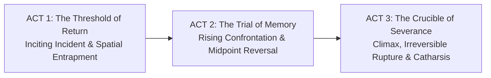

# DRAMATIC ARC & ACT BOUNDARY ANALYZER (`creative_brain/03_dramatic_arc_and_act_boundary_analyzer.md`)

## 1. THREE-ACT STRUCTURAL GEOMETRY
To translate unstructured prose into a cinematic narrative engine, Sub-System 00 maps the story across a classical Three-Act structural model calibrated for Indian episodic and feature pacing:

---

## 2. ACT BOUNDARY BENCHMARKS

### Act 1: The Threshold of Return (Setup & Moral Stasis — ~20-25% of runtime)
- **Primary Function:** Establishes the physical and moral world, the protagonist's core ghost/wound, and the catalyst that forces a return to the ancestral past.
- **Act Climax / Plot Point 1:** An irreversible action or threshold crossing that traps the protagonist inside the primary conflict zone (e.g., the monsoon rains trap Raghav inside the haveli overnight; the mother locks the outer courtyard gate).

### Act 2: The Trial of Memory (Rising Confrontation & Entropy — ~50% of runtime)
- **Part 2A:** The negotiation of the surface want (e.g., attempting to get signatures on legal partition deeds; exploring ancestral rooms).
- **The Midpoint Reversal:** A shocking discovery or emotional confrontation that shatters the protagonist's internal lie (e.g., Raghav discovers all his childhood money orders lying uncashed inside his father's brass paan-daan; his mother lived in poverty rather than spend his guilt-tainted money).
- **Part 2B:** The collapse of defense mechanisms into rage, physical fever, or spiritual breakdown.
- **Plot Point 2 / All Is Lost:** The absolute breakdown of communication; the ancestral house is flooded or papers are destroyed.

### Act 3: The Crucible of Severance (Catharsis & Transformation — ~25% of runtime)
- **The Climax:** The ultimate moral reckoning where the protagonist must choose between filial surrender and ruthless self-interest.
- **Resolution:** A final lingering image of transformed stasis (e.g., Raghav departing in dawn light, his father's mechanical watch ticking on his wrist, leaving the haveli standing in quiet dignity).

---

## 3. SCENE AND BEAT DECOMPOSITION RULES
When analyzing the raw Hindi text:
1. Every shift in location or significant passage of time (>15 minutes) creates a new Scene (`SCN_XX`).
2. Every scene must contain between 3 and 8 discrete **Dramatic Beats** (`SCNXX_BT01`, `BT02`...).
3. Every beat must be classified by its dramatic element:
   - `ACTION_KINAESTHETIC`: Physical staging or bodily interaction with the set/props.
   - `DIALOGUE_BLOCK`: Spoken verbal transaction.
   - `THEHRAAV_PAUSE`: Intentional silence where internal emotion shifts without dialogue.
   - `TRANSITION`: Scene in/out boundary condition.
