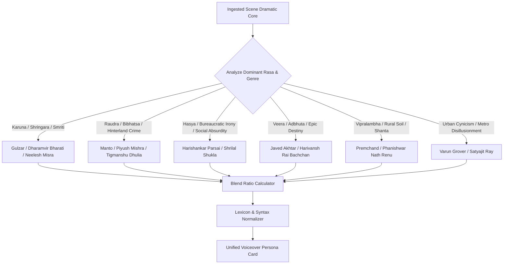

# WRITER BLENDING & VOICE SELECTION ROUTER (`00_writer_blending_and_voice_selection_router.md`)

## 1. THE SHOWRUNNER LITERARY SELECTION ALGORITHM
In the Hindi Cinema Autonomous Studio System, voiceover narration is not a monolithic generic voice. It is an art-directed authorial consciousness. The system dynamically assigns either a pure primary writer engine or calculates an authoritative **Weighted Dual-Writer Blend** (e.g., *70% Saadat Hasan Manto + 30% Piyush Mishra* or *55% Gulzar + 45% Munshi Premchand*).

---

## 2. THE 13 AUTHORIAL ENGINES TAXONOMY
The Voiceover Subsystem decompiles the literary minds of 13 master architects of Hindi and Hindustani dramatic literature:

| Engine ID | Master Author / Voice | Core Aesthetic Focus | Dominant Lexicon | Signature Pacing |
| :--- | :--- | :--- | :--- | :--- |
| `W01` | **Gulzar** | Sensory nostalgia, personified time, domestic tenderness, tactile silences | Tadbhava 45% / Rekhta 40% | 80–90 WPM |
| `W02` | **Munshi Premchand** | Agrarian realism, systemic debt, quiet dignity, moral irony | Khari Boli 55% / Awadhi 30% | 85–95 WPM |
| `W03` | **Saadat Hasan Manto** | Surgical neutrality, biological realism, stripped truth, naked shock | Raw Hindustani 60% / Urdu 35% | 95–108 WPM |
| `W04` | **Piyush Mishra / Anurag Kashyap** | Sardonic balladry, coal-and-gunpowder cynicism, irreverent folk-punk | Deshaj 50% / Street Hindi 35% | 110–128 WPM |
| `W05` | **Javed Akhtar / Salim-Javed** | Mythic elevation, architectural balance, heroic antithesis, sharp stings | Ganga-Jamuni Urdu 50% / Hindi 45% | 85–100 WPM |
| `W06` | **Dharamvir Bharati / Agyeya** | Existential interiority, psychological claustrophobia, philosophical ache | Sanskritized Chhayavad 50% / Hindi 40% | 75–88 WPM |
| `W07` | **Harivansh Rai Bachchan** | Epic Kathavachak gravitas, cosmic fatalism, rhythmic Khari Boli metric | High Tatsama 55% / Khari Boli 35% | 82–94 WPM |
| `W08` | **Neelesh Misra** | Intimate radio storytelling, micro-observational domesticity, slow pauses | Everyday Hindustani 65% / Tadbhava 25% | 88–98 WPM |
| `W09` | **Satyajit Ray** | Patrician detachment, intellectual irony, sociopolitical chess | Classical Bengali-infused Hindustani | 92–102 WPM |
| `W10` | **Varun Grover / Sudhir Mishra** | Contemporary disillusionment, dark comedic wit, modern small-town ache | Modern Hinglish/Hindi 50% / Urdu 35% | 100–114 WPM |
| `W11` | **Tigmanshu Dhulia** | Feudal Chambal/Awadhi power dynamics, masculine honor codes, dry blood | Bundeli-Awadhi 55% / Khari Boli 35% | 105–118 WPM |
| `W12` | **Phanishwar Nath Renu** | Anchalik sensory immersion, folk onomatopoeia, rural seasonal rhythm | Rural Maithili/Bhojpuri 60% / Hindi 30%| 82–92 WPM |
| `W13` | **Harishankar Parsai / Shrilal Shukla** | Deadpan bureaucratic satire, weaponized politeness, tragicomic mockery | Iron-sharp Khari Boli 60% / Formal 30% | 110–125 WPM |

---

## 3. MATHEMATICAL BLENDING ALGORITHM
When a scene requires multi-layered complexity (e.g., a political crime saga that also carries deep familial grief), the system calculates a weighted interpolation between two complementary engines:

$$	ext{Voiceover Syntax} = (W_A 	imes 	ext{Ratio}_A) + (W_B 	imes 	ext{Ratio}_B)$$

### Canonical Master Blends:
1. **The Tragic Heartland Noir (Crime + Family Ache):**
   - `60% W03 (Saadat Hasan Manto)` + `40% W01 (Gulzar)`
   - *Result:* Manto provides the unblinking, brutal physical reality of the violence; Gulzar introduces the piercing sensory grief of domestic objects left behind in the courtyard.
2. **The Cynical Power Epic (Feudal Politics + Black Satire):**
   - `50% W04 (Piyush Mishra)` + `50% W13 (Harishankar Parsai)`
   - *Result:* Mishra delivers the percussive, drumbeat hinterland swagger; Parsai injects cold, surgical mockery of institutional decay.
3. **The Intimate Historical Chronicle (Grand Civilizations + Human Loneliness):**
   - `55% W07 (Harivansh Rai Bachchan)` + `45% W08 (Neelesh Misra)`
   - *Result:* Bachchan provides the monumental baritone resonance of ancient time; Misra brings the listener into the candlelit room of a single forgotten soldier.
4. **The Modern Small-Town Existential Thriller (Youth Aspiration + Rot):**
   - `70% W10 (Varun Grover)` + `30% W06 (Dharamvir Bharati)`
   - *Result:* Grover roots the world in coaching centers, railway crossings, and smartphones; Bharati elevates the inner dread to cosmic guilt.

---

## 4. CONFLICT RESOLUTION & REGISTER HARMONIZATION
When blending two engines with contrasting vocabularies (e.g., High Tatsama of Bachchan vs. Raw Deshaj of Mishra):
1. **Noun Priority:** Concrete nouns are taken from the writer whose worldview matches the physical setting (e.g., rural utensils from Deshaj; philosophical concepts from Tatsama).
2. **Verb Cadence:** Sentence structure always matches the higher-tempo engine to avoid dragging, while pauses (`[THEHRAAV]`) are protected by the lower-tempo engine.
3. **Zero Register Clashing:** Never mix High Archaic Sanskrit and Low Urdu Slang in the same clause unless intentional satire is explicitly flagged.
