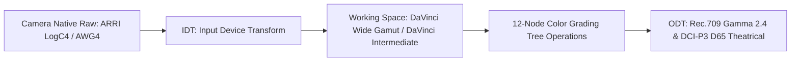

# ACEScct & DAVINCI WIDE GAMUT PIPELINE (`technical_brain/01_acescct_and_davinci_wide_gamut_pipeline.md`)

## 1. COLOR MANAGEMENT ARCHITECTURE
All color processing in Sub-System 05 operates within a **Scene-Referred 32-bit Floating Point Color Space**:

- **Input Device Transform (IDT):** ARRI Wide Gamut 4 (AWG4) / LogC4.
- **Working Timeline Color Space:** DaVinci Wide Gamut (DWG) / DaVinci Intermediate. Provides an ultra-wide color gamut encompassing visible spectrum wavelengths without clipping.
- **Output Device Transform (ODT):**
  - Web & Broadcast: Rec.709 Gamma 2.4.
  - Theatrical DCI: DCI-P3 D65 ST.2084 / Rec.2020 HDR.
